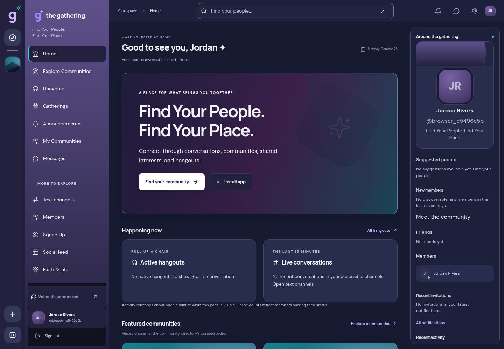
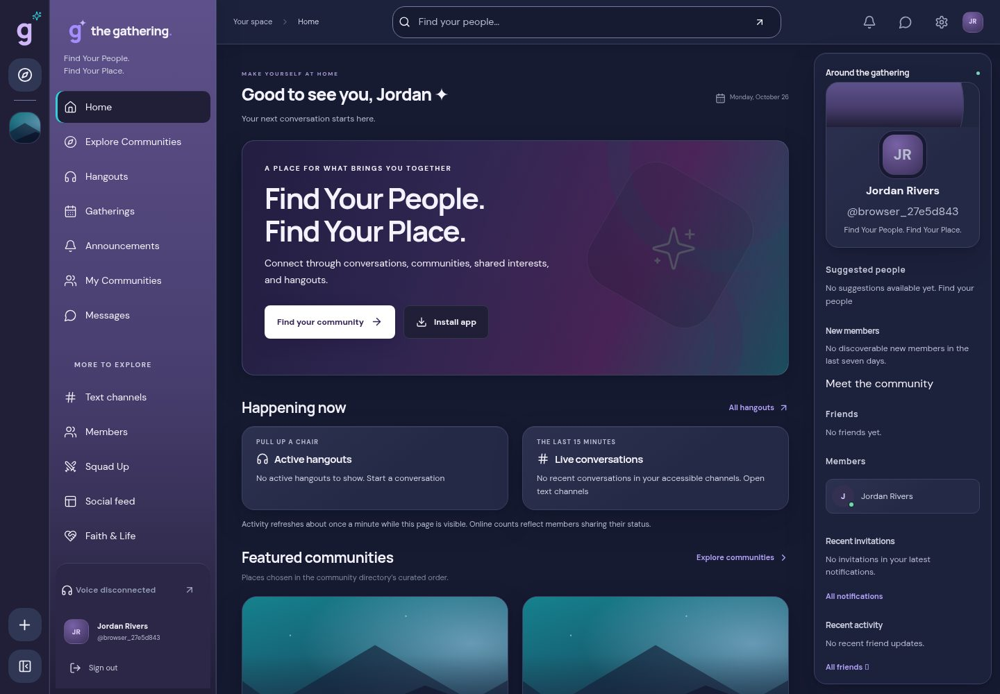

# Premium Digital Lounge — visual refinement

October 26, 2026. Baseline: `07cda9d`.

This is a presentation-only refinement of the existing app. Production changes are limited to three CSS files (`tokens.css`, `premium-shell.css`, `premium-discovery.css`) and the generated build/service-worker fingerprint. No backend, Auth, database schema, community records, messaging or LiveKit service implementation changed. Isolated local QA fixtures were created and cleaned up by the browser tests; production data was untouched.

## Reference interpretation and refinements

The approved reference works through distinct navy/lavender layers, visual community covers, controlled gradients and clear spatial hierarchy. The prior implementation had a tall hero/activity stack, equally strong card outlines and an oversized right-side identity card. Those made it feel more like a collection of dashboard boxes than a lounge.

- **Color hierarchy:** retained the exact primary brand primitives while deepening card/input/rail surfaces and giving lavender navigation a separate middle/footer tone. The rail, secondary panel, topbar and workspace now have distinct edges and quiet depth.
- **Gradients:** a more intentional violet → brand purple → magenta → cyan progression, with the existing protective text scrim adjusted to reveal more color. The actual rendered scrim retains a conservative **5.95:1** body-text contrast bound, including white artwork underneath. No animated gradients or scattered glow effects were added.
- **Cards:** existing authorized uploaded covers and owned fallback artwork remain. Covers have a stronger visual frame and quiet edge fade; softer decorative borders, layered neutral shadows, consistent rounded clipping and more generous inner spacing replace the heavy outlined appearance. Flex alignment keeps count/action rows balanced across variable descriptions. Horizontal cards keep their existing grid layout.
- **Typography/spacing:** reduced hero scale/padding and compressed the existing activity panels so Featured community images appear earlier. Section headings are more deliberate; content order, labels, counts and keyboard order remain. The contextual profile card is more compact, leaving more room for people/activity.
- **States:** selected navigation uses the existing cyan edge with a subtle inset highlight; card hover uses a precise cyan boundary, a two-pixel lift and slight image scaling. Input focus remains explicit. Existing reduced-motion rules suppress transitions/transforms. Shadows are dimensional dark shadows, not colored emission.
- **Responsive behavior:** retained existing rail/sidebar/drawer breakpoints and voice/composer layout ownership. Mobile cards remain single-column, fields wrap and touch controls preserve their existing sizes.

## Before / after

All comparison images were captured from a real local production build, using explicitly labelled, authorized QA data. They are not fabricated production communities or statistics. Profiles/usernames can differ between runs because each test creates a fresh isolated account. Comparisons use identical viewport widths/heights: **1440 × 1000**, **1024 × 1000**, **390 × 1000**. The broader mobile route checks also use 390 × 844.

| View | Before | After |
| --- | --- | --- |
| Desktop Home | [Before](qa/refinement/before/1440-home.jpg) | [After](qa/refinement/after/1440-home.jpg) |
| Tablet Explore | [Before](qa/refinement/before/1024-explore.jpg) | [After](qa/refinement/after/1024-explore.jpg) |
| Mobile Home | [Before](qa/refinement/before/390-home.jpg) | [After](qa/refinement/after/390-home.jpg) |
| Community cover/card | [Before](qa/refinement/before/1440-community-card.png) | [After](qa/refinement/after/1440-community-card.png) |
| Community overview | [Before](qa/refinement/before/1440-community.jpg) | [After](qa/refinement/after/1440-community.jpg) |

| Desktop before | Desktop after |
| --- | --- |
|  |  |

[All focused comparisons](qa/refinement/README.md) · [Card hover detail](qa/refinement/after/1440-card-hover.png)

Desktop/tablet/mobile Home, Explore, community and card comparisons were visually inspected, including the resulting mobile heading, cropping, navigation separation and hover detail. Captures disable finite animations for consistency. The existing art is deliberately retained; private uploads are not replaced with reference assets or stock/dummy members.

## Executed verification

- Lint and TypeScript checks pass.
- Full unit suite: **365 tests / 65 files pass**.
- Production build and production `next start` pass.
- Before captures: **2/2 browser scenarios pass**.
- After suite: **10/10 desktop/mobile browser scenarios pass in 3.9 minutes**, covering the focused comparisons, shell/community navigation and private-channel boundaries, the existing comprehensive route/axe suite, and actual two-account LiveKit audio with navigation/reconnect/permission checks. This includes **54 route/viewport scans** across 18 pages, three widths, axe WCAG A/AA, overflow, broken-image, hero contrast, heading alignment and composer-position checks. Those complete after-route captures were directed to `/tmp/refinement-page-captures` to preserve the Phase 8 evidence; focused before/after assets are committed here.
- Focused captures were refreshed with animations disabled: **2/2 pass**.
- Added **12 Linux Chromium component pixel baselines**: Home/Explore/community heroes and the community card at the three widths. Live count text is masked only for pixel comparison; actual data/permissions and image loading remain asserted. Baseline creation passed **2/2**; a separate run without snapshot updates passed **2/2 in 23.2 seconds**, verifying all twelve component comparisons. No golden was updated during that comparison run.

The snapshot allowance is 0.3% per clipped component to tolerate text anti-aliasing; it is not permission to accept layout changes blindly. Review image diffs before updating goldens. Run `npx playwright test e2e/visual-refinement.spec.ts` against the isolated local services and a production preview for normal comparison; `--update-snapshots` is only for reviewed visual changes. Use `VISUAL_REFINEMENT_PHASE=before` or `after` for the focused comparison captures. The general QA capture directory can now be overridden by `PREMIUM_VISUAL_OUTPUT`; its normal default is unchanged.

Physical Safari/Android/OS keyboard/zoom/screen-reader and hosted-load acceptance remain outside this local visual exercise. Generated capture audio through real LiveKit does not certify physical microphones. No migration or production deployment is part of this change.
